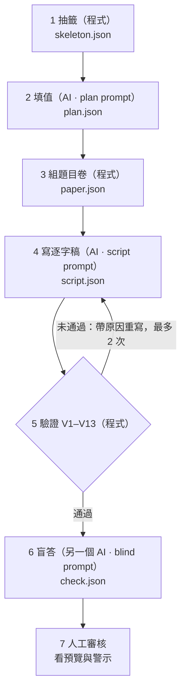

# 填空模組（gap-fill）實作規格 v0.3

範圍：第一版只做 **Section 1 的表格填空，10 題**。單選、複選、配對、地圖題之後再做。

**v0.2 的來源：** 吸收了一份第三方 CTO 審查。審查指出的問題，有共識的已直接改進規格；有分歧的，集中列在下面的「有爭議事項」，並在內文用標示圈出來。

**v0.3 的改動：** 依 10/16 的討論，抽籤改成「程式排 10 題骨架，AI 只填內容」；每個主題要有情境變體與約 18 個欄位；新增配方可行性檢查；並核對了雅思格式，修正設定檔的來源標註。新增一項爭議 G。

## 如何閱讀這份文件

- 沒有標示的內容，都是**已定案**，M1 會照這個做。
- ⚠️【有爭議】代表審查意見和我的立場不同，或和你先前說的優先順序衝突，**需要你拍板**。
- 🔍【待查證】代表事實還沒核對（目前只有一項：我沒有直接讀到 ielts.org 官網）。

## 有爭議事項一覽（只需要看這張表）

| # | 事項 | 審查的意見 | 我的立場 | 我建議你選 |
|---|---|---|---|---|
| A | ⚠️【有爭議】 帳號與付費放在哪個時間點 | 帳號、權限、付費先暫緩，等證明有人願意持續使用再做 | 你說過「產生題目與測試，還有帳號才是重點」；但這和 10/22 的付費頁測試門檻是同一件事 | M5 留在路線圖，但**開工條件**是 M4 完成，加上候補頁有名單訊號。你若堅持先做，也可以，只是 M5 前不收費 |
| B | ⚠️【有爭議】 重新拆成「生成、品質保證、交付」三條管線 | 建議重新整理成三條責任明確的管線 | 這只是命名與分資料夾的問題，不改變實作。第一版仍是 Node 腳本加檔案 | 不重構，只在文件裡用三個名字描述分工 |
| C | ⚠️【有爭議】 抽籤的「90 天不重複」與多種陷阱配方 | 過早，題庫小的時候會讓流程卡死 | 同意配方先做少量固定；「90 天」我想保留成設定值，不寫死 | 配方先做 3 種；90 天設成 `0`（關閉），主題超過 10 個再打開 |
| D | ⚠️【有爭議】 音檔時間軸的優先級 | 列為 P0，需要句子層級時間，且必須來自實際音檔 | 同意時間必須來自實際音檔；但 M4 才有真音檔，現在不是 P0 | M4 再做，先做 turn 層級；句子層級等有實際需求再加 |
| E | ⚠️【有爭議】 「你常錯哪一種」的分析呈現 | 單次作答不足以下結論，先只給答對率與錯題紀錄 | 標籤要在生成時就寫進資料，這個成本很低，不能省；呈現方式同意保守 | 標籤照寫；結果頁只顯示各類型答對率，**累積 5 次以上**才出現「弱點」字樣 |
| F | ⚠️【有爭議】 TTS 要不要做抽象層 | 先選一家驗證品質，不要先做多家抽象 | 我們的「抽象」只有一個函式，成本接近零，我想保留 | 保留一個函式的介面，只接一家；`dev` 瀏覽器語音只用來測前端 |
| G | ⚠️【有爭議】 具體的值（姓名、日期、電話、門牌）由誰生 | 審查沒有涉及（10/16 討論新增） | 你的想法是由 AI 生。我擔心 AI 會一再編出同樣的名字，也不好追查重複 | 第一版照你的想法由 AI 生；M2 如果發現重複，再改成程式從詞庫抽，AI 只寫對話與需要語意的值 |

其他審查意見（V3、V6、V10 規則、單一真實來源、整份重驗、版本欄位、正向測資、盲答降級、normalize 拆分、考試規則與產品設定分離）我都**同意並已寫進本文，不列為爭議**。

## 0. 先講結論

1. **生成流程是 6 個階段（和簡報的六步驟一一對應：選主題、答案清單、逐字稿、題目卷、盲答、語音）。** 每個階段的輸入輸出都是 JSON 檔，任何一步失敗都能從那一步重跑。
2. **能用程式檢查的，就不要靠 AI 檢查。** 驗證器是純程式（第 6 節），AI 盲答只用來抓「程式看不出來的歧義」，而且只當**警示**，不當最終裁決。
3. **`plan.json` 是答案與題目結構的唯一來源。** 逐字稿、題目卷、評分都引用同一組 `question_id` 與 `field_id`，不讓 AI 重新解讀題意。（v0.2 新增）
4. **AI 的步驟先用「人工模式」跑：** 腳本印出 prompt，你（或 Claude Code）產生 JSON 存檔，再跑驗證器。之後要接 API，只換一個 `llm` 轉接器。
5. **評分和驗證共用同一個答案比對函式。**
6. **每題帶標籤**（題型、陷阱類型），這是日後分析的資料來源，要在生成時就寫進去。
7. **原則：資料模型容易擴充，但只實作已經確定的需求。** 保留 `question_type`、`field_id` 這些識別欄位，不預先設計能涵蓋地圖題、配對題的通用題目引擎。（v0.2 修正）
8. **選主題與排 10 題骨架是純程式，AI 只填內容。** 哪個欄位配哪個陷阱，是影響題目品質的規則，不讓模型每次自己判斷。（v0.3 新增）

### 0.1 M1～M2 的出題流程圖



顏色分工：1、3、5 是程式；2、4、6 是 AI；7 是人。M1 完成 1、3、5（以及批改）；M2 完成 2、4、6 的 prompt 與組裝，並實際跑過一次（`content/sets/s1-library-0001`）。

分工的描述（不改變實作，見爭議 B）：

| 責任 | 內容 | 階段 |
|---|---|---|
| 生成 | 產生內容，不判斷合不合格 | 1 到 4 |
| 品質保證 | 攔截錯誤，不合格不得進題庫 | 驗證器、5 盲答、人工抽樣 |
| 交付 | 音檔、作答、評分、重聽 | 6 以及評分與測驗頁 |

## 1. 資料夾結構

```
config/
  exam-profile.json             考試規則與產品設定，每個值標註來源
content/
  topics/library-card.json      主題模板（一個主題一個檔）
  recipes/section1.json         陷阱配方
  sets/<set-id>/                一份題目一個資料夾，例如 s1-library-0001
    skeleton.json               階段 1：10 題骨架（程式產生）
    plan.json                   階段 2：答案與題目結構（唯一來源）
    script.json                 階段 3：逐字稿與證據定位
    paper.json                  階段 4：題目卷（程式產生）
    check.json                  階段 5：盲答結果
    audio/full.mp3              階段 6
    audio/timing.json           每一輪在音檔裡的起訖秒數（來自實際音檔）
    meta.json                   狀態、版本、輸入雜湊、重試次數、抽籤種子
generator/
  cli.mjs                       命令列：draw、validate
  draw.mjs                      選主題、排骨架
  paper.mjs                     題目卷
  validate.mjs                  驗證器
  normalize.mjs  answer.mjs     字串正規化與各 answer_policy（驗證與評分共用）
  artifact.mjs                  版本、輸入雜湊、過期判斷
  plan.mjs  script.mjs  blind.mjs  tts.mjs  llm.mjs   （M2 以後）
  schemas/*.schema.json
  prompts/*.md
tests/
  fixtures/good-0001/           一份手寫的完整正確題目（也是 M3 的示範題）
```

`meta.json` 的 `status` 依序是：`drawn` → `planned` → `scripted` → `papered` → `validated` → `blind_passed` → `reviewed` → `voiced` → `published`。（v0.2 新增 `reviewed`：人工審過。）任何階段失敗，狀態停在前一個。

## 2. 階段 1：選主題與排骨架（draw）— 純程式，不用 AI

輸入：主題庫、配方庫、考試設定、種子、歷史紀錄。輸出：`skeleton.json`（10 題骨架，**還沒有任何答案**）。

### 2.1 抽籤流程（v0.3 重寫）

1. 從主題池抽一個主題（排除冷卻中的主題，見 2.2）。
2. 抽一個情境變體。同一個主題可以有不同設定（例如辦證的人是學生或新居民），有些欄位只在特定變體才會出現。
3. 抽一個陷阱配方：各種陷阱各幾題，加起來剛好 10；不抽上一份用過的配方。
4. 從這個主題、這個變體可用的欄位池，抽出 10 個欄位。成組的欄位（例如門牌與街名）要一起抽，或一起不抽。
5. 依每個欄位允許的陷阱，把配方的陷阱配到欄位上，每個欄位只放一個陷阱。
6. 題號照表格由上到下排。沒抽到的欄位，整列從表格拿掉。

第 4、5 步的做法：用種子隨機挑一組欄位，檢查配方的陷阱能不能完整配上；配不上就換一組，最多 300 次。仍然失敗就換下一個配方；全部失敗，回報 `NO_ELIGIBLE_CANDIDATE` 並說明原因，**不無限重抽**。這個檢查叫「配方可行性檢查」。

同一個種子、同樣的主題檔與配方檔，產生同樣的骨架。主題檔或配方檔改了，輸入雜湊會變，舊骨架被標為過期（第 12.1 節）。

### 2.2 抽籤限制 ⚠️【有爭議】（見爭議 C）

- 同一個陷阱配方不可連續兩份使用。（定案）
- 配方第一版只做 3 種固定的。（定案，審查與我一致）
- 同一個主題 N 天內不重複。**N 放在設定檔，預設 0（關閉）**，主題超過 10 個再打開。審查認為整條規則過早；我主張保留成設定值。

### 2.3 考試規則與產品設定分開（v0.3：已核對）

`config/exam-profile.json` 的每個值都標註來源（`idp`、`third_party`、`product`）。這次我核對了三個頁面：IDP 的聽力頁、EF、Kaplan。

| 設定 | 值 | 來源 |
|---|---|---|
| 全卷結構 | 4 段、共 40 題；Section 1 是兩人的日常對話 | IDP |
| 每段題數 | 10 | Kaplan |
| 錄音只播一次 | 是 | IDP、EF、Kaplan |
| 題目印刷順序等於答案出現順序 | 是 | EF |
| 看題時間 | 約 30 秒 | Kaplan（IDP、EF 只說「有一段時間」） |
| 檢查時間 | 每段約 30 秒；電腦版全卷結束後有 2 分鐘 | Kaplan；IDP |
| 字數上限含冠詞與介系詞 | 是 | Kaplan |
| 口音 | 多種（英、美、澳等） | IDP、EF |
| 逐字稿 650 到 800 字、題與題至少隔 25 字、暖身至少 3 輪 | — | 產品設定，我們自己訂的 |

🔍【待查證】我沒有直接讀到 ielts.org 官網。標 Kaplan 的是第三方描述，不是官方文件。v0.2 把檢查時間設成 120 秒，現在依資料改成 30 秒（單一 Section 練習的設定），要改回去只改設定檔。

```json
{
  "section":             { "value": 1,  "source": "product" },
  "question_count":      { "value": 10, "source": "third_party" },
  "play_once":           { "value": true, "source": "idp" },
  "preview_seconds":     { "value": 30, "source": "third_party" },
  "check_seconds":       { "value": 30, "source": "third_party", "note": "電腦版全卷結束後另有 2 分鐘（idp）" },
  "target_words":        { "value": [650, 800], "source": "product" },
  "min_gap_words":       { "value": 25, "source": "product" },
  "min_warmup_turns":    { "value": 3,  "source": "product" },
  "topic_cooldown_days": { "value": 0,  "source": "product" }
}
```

### 2.4 主題模板（v0.3 重寫）

每個主題一個 JSON 檔，**手寫**。一個主題至少 18 個欄位、2 個情境變體。

```json
{
  "id": "library-card",
  "title": "圖書館辦證",
  "section": 1,
  "speakers": [
    { "id": "A", "role": "圖書館櫃台職員" },
    { "id": "B", "role": "來辦證的民眾" }
  ],
  "form": {
    "title": "Library Membership Application",
    "instruction": "Write NO MORE THAN TWO WORDS AND/OR A NUMBER for each answer.",
    "rows": [
      { "label": "Application type", "printed": "New membership" },
      { "label": "Family name", "field_id": "family_name" },
      { "label": "Date of birth", "field_id": "date_of_birth" },
      { "label": "House number", "field_id": "house_number" },
      { "label": "Street", "field_id": "street_name" }
    ]
  },
  "variants": [
    { "id": "student", "setting": "辦證的人是大學生" },
    { "id": "resident", "setting": "辦證的人是剛搬來的居民" }
  ],
  "fields_pool": [
    { "field_id": "family_name", "type": "name_spelled", "allowed_traps": ["spelling", "none"], "answer_policy": "exact_word", "max_words": 1 },
    { "field_id": "house_number", "type": "number", "allowed_traps": ["similar_numbers", "self_correction", "none"], "answer_policy": "digits_only", "max_words": 1, "group": "address" },
    { "field_id": "street_name", "type": "name_spelled", "allowed_traps": ["spelling", "none"], "answer_policy": "exact_word", "max_words": 2, "group": "address" },
    { "field_id": "student_number", "type": "number", "allowed_traps": ["similar_numbers", "none"], "answer_policy": "digits_only", "max_words": 1, "only_variants": ["student"] }
  ]
}
```

（上面只列 4 個欄位示意。完整的 18 個欄位在 M1 寫成：姓、名、生日、門牌、街名、城鎮、電話、職業、學生證號、居住年數、偏好分館、取證日、辦證原因、會員類型、閱讀興趣、到館頻率、得知管道、通知方式。）

規則：

- `form.rows` 是表格由上到下的順序，**也是題號與音檔的順序**。`printed` 是印好的固定文字，內容不得與任何答案衝突；有 `field_id` 的列是候選空格。
- 每個欄位標明類型、允許的陷阱、比對規則、字數上限；`group` 是成組欄位；`only_variants` 表示只在特定變體出現。
- **欄位限制由資料決定，不讓生成模型自己判斷哪個陷阱適合哪種欄位。** 例如日期不套拼字，電話不套同義改寫。

### 2.5 陷阱配方

陷阱類型固定 5 種加「無陷阱」。配方是各類型各幾題，加起來 10，手寫，第一版 3 種：

```json
[
  { "id": "R1", "traps": { "self_correction": 2, "spelling": 2, "similar_numbers": 2, "paraphrase": 1, "distractor": 1, "none": 2 } },
  { "id": "R2", "traps": { "self_correction": 1, "spelling": 3, "similar_numbers": 2, "paraphrase": 2, "distractor": 0, "none": 2 } },
  { "id": "R3", "traps": { "self_correction": 2, "spelling": 1, "similar_numbers": 3, "paraphrase": 1, "distractor": 1, "none": 2 } }
]
```

### 2.6 骨架長什麼樣

這就是階段 1 的輸出，也是階段 2 的輸入。裡面只有結構，沒有答案：

```json
{
  "seed": 20261016,
  "topic": "library-card",
  "variant": "student",
  "recipe": "R1",
  "slots": [
    { "question_id": "q01", "field_id": "family_name",      "type": "name_spelled", "trap": "spelling",        "answer_policy": "exact_word",       "max_words": 1 },
    { "question_id": "q02", "field_id": "date_of_birth",    "type": "date",         "trap": "self_correction", "answer_policy": "date_equivalence", "max_words": 2 },
    { "question_id": "q03", "field_id": "house_number",     "type": "number",       "trap": "similar_numbers", "answer_policy": "digits_only",      "max_words": 1, "group": "address" },
    { "question_id": "q04", "field_id": "street_name",      "type": "name_spelled", "trap": "spelling",        "answer_policy": "exact_word",       "max_words": 2, "group": "address" }
  ]
}
```

（示意只列 4 題，實際是 10 題。）

## 3. 階段 2：答案清單（plan）— 第一個 AI 步驟

輸入：`skeleton.json`（第 2 節）。輸出：`plan.json`。**AI 只替每一列填具體的值，不能改欄位、陷阱、比對規則和題號。這一步還沒有逐字稿。這份檔案是題目與答案的唯一來源。**

```json
{
  "set_id": "s1-library-0001",
  "topic": "library-card",
  "variant": "student",
  "recipe": "R1",
  "seed": 20261016,
  "scenario": { "setting": "市立圖書館櫃台", "accent": "en-GB" },
  "form": { "title": "Library Membership Application", "instruction": "NO MORE THAN TWO WORDS AND/OR A NUMBER" },
  "answers": [
    {
      "question_id": "q01",
      "field_id": "family_name",
      "answer": "Hargreaves",
      "accepted": [],
      "type": "name_spelled",
      "trap": "spelling",
      "answer_policy": "exact_word",
      "note": "B 會逐字母唸出來"
    },
    {
      "question_id": "q02",
      "field_id": "date_of_birth",
      "answer": "14 March",
      "accepted": ["March 14", "14th March"],
      "type": "date",
      "trap": "self_correction",
      "answer_policy": "date_equivalence",
      "wrong_value": "13 March",
      "note": "先講 13，再更正成 14"
    }
  ]
}
```

| 欄位 | 意義 |
|---|---|
| `question_id` | `q01` 到 `q10`，**順序必須等於該答案在音檔中出現的先後** |
| `field_id` | 對應題目卷表格的欄位，逐字稿與題目卷都用它 |
| `answer` | 標準答案 |
| `accepted` | 可接受的其他寫法（依 `answer_policy` 另行規定，不靠 `normalize` 猜） |
| `type` | `name_spelled`、`number`、`date`、`phone`、`time`、`price`、`word`、`place` |
| `trap` | `none`、`self_correction`、`spelling`、`similar_numbers`、`paraphrase`、`distractor` |
| `answer_policy` | 比對規則，見第 6 節 |
| `wrong_value` | 只有 `self_correction` 與 `distractor` 需要 |

**階段 2 的 prompt 規則（`prompts/plan.md`）：**

- 所有人名、地址、電話都必須虛構。電話用英國保留給戲劇的號段（07700 900000 到 900999），email 用 example.com。
- 答案不得是只有一種寫法卻很罕見的字（會變成考拼字，不是考聽力）。拼字題限定在名字、街名，並且必須在逐字稿裡逐字母唸出來。
- `answer` 要符合表格字數限制。
- 骨架是固定的：`question_id`、`field_id`、`type`、`trap`、`answer_policy` 一律照抄，不得增減或改動。
- `self_correction` 與 `distractor` 要填 `wrong_value`。
- 同一題內不得有歧義；不同欄位的答案可以有字面重疊（例如 `King Street` 與 `King Street West` 分屬兩個欄位時是合法的）。（v0.2 修正）

**具體的值由 AI 生 ⚠️【有爭議】（見爭議 G）：** 第一版照你的想法，姓名、日期、電話、門牌都由 AI 在這一步編。風險是同樣的名字會一再出現。M2 實際產出幾份後如果發現重複，改成程式從詞庫抽，AI 只負責對話與需要語意的值（職業、原因等）。

## 4. 階段 3：逐字稿（script）— 第二個 AI 步驟

輸入：`plan.json`。輸出：`script.json`。

```json
{
  "set_id": "s1-library-0001",
  "turns": [
    { "id": "t1", "speaker": "A", "text": "Good morning. How can I help you?" },
    { "id": "t5", "speaker": "B", "text": "Hargreaves. That's H-A-R-G-R-E-A-V-E-S." }
  ],
  "evidence": [
    { "question_id": "q01", "turn": "t5", "quote": "That's H-A-R-G-R-E-A-V-E-S." }
  ]
}
```

**`evidence` 只是定位索引，不是證據本身（v0.2 修正）。** 驗證器要用 `turns` 的原文核對：`quote` 必須是該輪 `text` 的**原文子字串**；答案要在 `quote` 或其所在句子裡。AI 即使在 `evidence` 裡寫了正確答案，只要逐字稿沒有，就失敗。

**階段 3 的 prompt 規則：**

- 以 `plan.json` 為唯一依據，不得新增或更動答案。
- 長度目標約 650 到 800 個英文單字，**這是品質指標，不是要逼模型補字的硬門檻**（見第 6 節的分級）。
- 第 1 題之前至少 3 輪不含答案（暖身）。
- 題與題之間至少隔 25 個單字，避免擠在同一句。
- 口語要自然：有停頓、`well`、`um`、重複，但不能影響聽懂。
- 逐字母拼字寫成 `H-A-R-G-R-E-A-V-E-S`。

**重寫規則（v0.2 修正）：** 可以只重寫失敗題相關的輪次，但每次重寫後**一律重新驗證整份逐字稿**：所有答案順序、題目間距、總長度都要重跑。不假設局部修改只有局部影響。

## 5. 階段 4：題目卷（paper）— 程式，不用 AI

輸入：`plan.json`。輸出：`paper.json`。**機械轉換，用 `field_id` 對應表格欄位，不需要 AI。**

```json
{
  "set_id": "s1-library-0001",
  "type": "form_table",
  "title": "Library Membership Application",
  "instruction": "Write NO MORE THAN TWO WORDS AND/OR A NUMBER for each answer.",
  "rows": [
    { "label": "Application type", "parts": [{ "text": "New membership" }] },
    { "label": "Family name", "field_id": "family_name", "parts": [{ "blank": "q01" }] },
    { "label": "Date of birth", "field_id": "date_of_birth", "parts": [{ "blank": "q02" }] }
  ]
}
```

`parts` 是文字與空格交錯的陣列，`blank` 放 `question_id`。**題目卷不得洩漏答案**，檢查範圍見 V6。

## 6. 驗證器（validate）— 純程式

在階段 3、階段 4 之後各跑一次。每條規則有**等級**：「擋」代表失敗就停止；「警示」代表只提醒、不擋，要你看過。（v0.2 新增等級）

| # | 檢查 | 等級 |
|---|---|---|
| V1 | `plan`、`script`、`paper` 都符合 schema；`question_id`、`field_id` 三份檔案一致 | 擋 |
| V2 | 剛好 10 題，`question_id` 為 `q01` 到 `q10` 不重複 | 擋 |
| V3a | 每筆 `evidence.quote` 是對應 `turn` 原文的子字串 | 擋 |
| V3b | 該題答案（或 `accepted` 之一）依 `answer_policy` 比對後出現在 `quote` 所在句子 | 擋 |
| V4 | `evidence.turn` 的順序與 `question_id` 一致 | 擋 |
| V5 | 每題答案字數不超過 `form.instruction` 與該欄位的上限；**字數含冠詞與介系詞**，連續的數字算一個「數字」 | 擋 |
| V6 | 答案不得出現在 `paper.json` 的**學生可見文字**：標題、說明，以及**該題所在那一列**的標籤與已印好的文字。別列已印好的值剛好和某題答案相同，不算洩漏 | 擋 |
| V7 | `self_correction`：`wrong_value` 出現在證據當輪或前兩輪，且早於正確答案；`distractor`：`wrong_value` 出現在證據前後各兩輪之內 | 擋 |
| V8 | `spelling`：逐字稿含逐字母格式，且拼出來等於答案 | 擋 |
| V9 | `similar_numbers`：逐字稿含成對的相近數字之一，且答案是其中之一 | 擋 |
| V10 | 只檢查「**同一題**的語境下可能互相混淆」的答案碰撞；不同欄位的字面重疊不算 | 擋 |
| V11 | 全文長度約 650 到 800 字（±15%）；題間距與暖身輪數 | 長度「警示」，題間距與暖身輪數「擋」 |
| V12 | 電話只用 07700 900xxx；email 只用 example.com；人名不在黑名單 | 擋 |
| V13 | `plan.json` 每題的 `question_id`、`field_id`、`type`、`trap`、`answer_policy` 都與 `skeleton.json` 一致；骨架本身符合配方數量，且每個陷阱都是該欄位允許的 | 擋 |

### 6.1 `normalize` 與 `answer_policy` 分開（v0.2 修正）

**`normalize` 只做字串層級**，驗證與評分共用，一個函式、一組測試：

1. 轉小寫、去頭尾空白、連續空白壓成一個。
2. 去掉結尾標點，統一撇號。

**其他全部交給 `answer_policy`，依欄位類型決定：**

| `answer_policy` | 規則 |
|---|---|
| `exact_word` | 比對 `answer` 與 `accepted`，拼錯就是錯。連字號與空白視為相同**只在這個策略下**成立 |
| `date_equivalence` | 解析成年月日再比；`14 March`、`March 14`、`14th March` 視為相同 |
| `digits_only` | 去掉空白與連字號後比較數字 |
| `number_word` | `2` 與 `two` 視為相同，第一版只處理 0 到 20 |

**不做模糊比對。** 英美拼字、縮寫、專有名詞的變體一律寫進 `accepted`。每個策略有獨立測試。

## 7. 階段 5：盲答驗證（blind）— 第三個 AI 步驟

**目的：抓程式看不出來的歧義。盲答是「品質警示」，不是絕對真理。**（v0.2 修正）

輸入：只有 `script.json` 的 `turns`（不含 `evidence`）與 `paper.json`。**不給 `plan.json`。** 輸出：`check.json`。

判定：

- 盲答某題與標準答案不符：**警示，要人工判斷**，不直接當題目有誤，因為可能只是模型誤聽。
- 盲答的 `alternatives` 不是空的：**警示**，要你看一眼，不直接判歧義，因為合理的語意分析也會產生備選。
- 盲答通過**不能取代**人工抽樣。第一版**每一份都要你親自讀過**再發布，題庫變大後改抽樣。
- 每一個被警示的題目，你的判定與原因寫進 `meta.json`，之後統計哪種陷阱最容易有問題。

**失敗處理：** 失敗題號丟回階段 3 只重寫相關輪次，**重寫後整份重新驗證**（第 4 節）。最多重試 2 次，超過就整份丟棄。

**獨立性：** 人工模式下，盲答要在全新的對話或子代理裡做，只給那兩個檔案。

## 8. 階段 6：語音（tts）

輸入：驗證通過且人工審過的 `script.json`。輸出：`audio/full.mp3` 與 `audio/timing.json`。

介面只有一個函式，與服務商無關：

```js
// generator/tts.mjs
export async function synthesize({ text, voiceId, accent }) { /* 回傳音檔位元組與長度 */ }
```

流程：每一輪單獨合成；輪與輪之間插入 0.4 到 0.8 秒靜音；串成 `full.mp3` 並寫 `timing.json`。

### 8.1 時間軸 ⚠️【有爭議】（見爭議 D）

- 共識：時間必須**來自最終合成的音檔**，不能用文字長度估算；音檔每次重生都要重算。
- 第一版只記錄 turn 層級（每一輪的起訖）。
- 分歧：審查把句子層級時間列為 P0；我認為等有實際需求（使用者覺得跳到整輪不夠準）再加，且要到 M4 才有真音檔可測。

### 8.2 服務商與抽象層 ⚠️【有爭議】（見爭議 F）

- 共識：先只接**一家**服務，驗證品質（尤其是逐字母拼字與數字念法）。
- 分歧：審查建議不做抽象層；我保留上面那個單一函式的介面，因為它幾乎沒有成本，換服務商時只改一個檔案。
- `dev` 模式（瀏覽器內建語音）**只用來測前端流程，不代表正式音檔品質**，不作為品質驗收依據。（v0.2 修正）
- 服務商 M4 前才選。逐字母拼字先做樣本測試，不合格就改用逗號分隔或 SSML 拼讀標記。

## 9. 評分（grade）

```js
grade(paper, plan, userAnswers) // → { total, results: [{ question_id, given, expected, correct, type, trap }], byType, byTrap }
```

- 每題依 `answer_policy` 比對 `answer` 與 `accepted`；**離線驗證與正式評分必須用同一套程式**，並有一致性測試。
- 另外統計 `byType`、`byTrap`。
- **標準答案不能在測驗期間送到瀏覽器。** 第一版靜態頁沒有後端，答案只能先放前端，只適合測試版；上帳號後評分搬到伺服器。

### 9.1 弱點分析的呈現 ⚠️【有爭議】（見爭議 E）

- 共識：標籤要在生成時就寫進資料，這個成本很低。
- 分歧：審查主張一開始只顯示答對率與錯題紀錄；我同意呈現要保守，但不同意不存標籤。
- 暫定做法：結果頁只顯示各類型答對率；同一類型累積**至少 5 次作答**，才會出現「你常錯這一類」這種結論性字句。

## 10. 測驗頁流程（前端）

流程時間取自 `config/exam-profile.json`，不寫死在程式裡。

1. **進入頁面**：說明與「開始」按鈕。
2. **預覽**：顯示題目卷與倒數，音檔還沒播。
3. **播放**：沒有暫停、倒轉、進度條。
4. **作答**：播放中就能填。
5. **檢查**：音檔播完後倒數檢查。
6. **送出**：呼叫 `grade`。
7. **結果頁**：每題顯示「你寫的、正確答案、答案在哪一句、聽這一輪」，最上面顯示各類型答對率。

## 11. 測試怎麼做

**每一條驗證規則要有「會失敗」的測資，也要有「合法卻長得像錯的」測資。** 後者是 v0.2 新增：如果只有失敗測資，驗證器把所有題目都拒絕也會看似通過。

| 固定測資 | 預期 |
|---|---|
| `good-0001`：一份完全正確的題目 | 全部通過 |
| 答案只在 `evidence` 裡，不在真實逐字稿 | V3a 或 V3b 失敗 |
| `quote` 不是原文子字串 | V3a 失敗 |
| 答案出現在題目卷的提示文字 | V6 失敗 |
| 自我更正但沒有 `wrong_value` | V7 失敗 |
| 拼字題沒有逐字母 | V8 失敗 |
| 字數超限 | V5 失敗 |
| 題號順序和音檔順序相反 | V4 失敗 |
| 電話用真實格式 | V12 失敗 |
| 缺欄位、重複題號、答案數量不一致 | V1、V2 失敗 |
| **合法：** 不同欄位的答案 `King Street` 與 `King Street West` | V10 通過 |
| **合法：** 全文只有 600 字 | V11 長度只出警示，不擋 |
| 整份重跑：同一輸入、同一版本 | 產出相同 |
| 修改輸入後 | 舊產物被標為過期 |
| 同一個種子抽兩次 | 骨架完全相同 |
| 不同種子 | 骨架有差異 |
| 配方要 5 個拼字，欄位池只有 4 個允許拼字 | 回報 `NO_ELIGIBLE_CANDIDATE`，不硬湊 |
| 成組欄位被拆開 | 抽籤測試失敗 |
| `plan.json` 的陷阱與骨架不一致 | V13 失敗 |
| 別列已印好的值與某題答案相同 | V6 通過 |

**`normalize` 與各 `answer_policy` 的測試：** 大小寫、標點、撇號；日期順序與序數；電話格式；`2` 對 `two`；再加「拼錯必須判錯」與「連字號只在 `exact_word` 下等同空白」。

**評分一致性測試：** 同一份標準答案與使用者答案，離線驗證與正式評分結果必須一致。

## 12. 里程碑與驗收

| 里程碑 | 內容 | 怎麼算完成 |
|---|---|---|
| M1 | 格式、`normalize`、各 `answer_policy`、驗證器、固定測資，加上手寫的圖書館辦證主題、3 種配方、抽籤與排骨架 | 下面 8 項全部通過 |
| M2 | prompt 模板、人工模式流程、盲答、`meta.json` 指紋鏈與狀態（第 12.1 節） | 產出 1 份真實題目，通過驗證與盲答警示處理，你親自讀過逐字稿；改任何上游檔案或 prompt，`status` 能指出哪一步過期 |
| M3 | 評分與測驗頁（用 `dev` 語音測 UI） | 你在瀏覽器完整做完一份，結果頁正確 |
| M4 | 選一家 TTS、`timing.json`（turn 層級） | 你戴耳機聽，覺得聽得懂、拼字念清楚 |
| M5 | 帳號與作答紀錄 | 見第 13 節，開工條件有爭議 |

**M1 的 8 項驗收（v0.3 加了第 8 項）：**

1. Schema 與題號：缺欄位、重複題號、答案數量不一致都能正確拒絕。
2. 答案與證據：答案只在 `evidence`、不在逐字稿時必須失敗。
3. 答案比對：大小寫、標點、日期、數字各有明確測試。
4. 陷阱驗證：自我更正、拼字、相近數字驗證實際語境，不只檢查字串存在。
5. 反向測試：合法題目不會因為答案字面重疊或固定內容而被拒絕。
6. 評分一致性：離線驗證與正式評分結果一致。
7. 重跑與版本：同一輸入與版本可重現；修改輸入後能辨識舊產物已過期。
8. 抽籤：同一種子可重現；不同種子有差異；配方排不出來時回報錯誤，不硬湊；成組欄位不被拆開；每個陷阱都是該欄位允許的。

**先做 M1。** 它不需要 AI 和任何服務，後面每一步都依賴它。

**目前進度（2026-10-16）：** M1 完成，M2 完成第一份真實題組（s1-library-0001）。兩者合起來還是「積木」：各步驟的程式與 prompt 都能單獨運作，但還沒有一個指令把整條流程串起來，AI 那三步仍靠人工貼 prompt、存 JSON、再用 `assemble` 組回去。串起來與存題庫屬於 M3 之後。


### 12.1 產物版本與不可變發布（v0.2 新增）

每個產物（`plan`、`script`、`paper`、`check`、`audio`）都記錄：

- `schema_version`、`generator_version`
- 輸入產物的雜湊
- 模型與提示版本（`manual` 模式也要記是哪個對話或模型產的）
- 建立時間與驗證結果

**實作（M2）：** 所有指紋都存在每套題的 `meta.json`，不改動 plan、script 等內容檔。每個階段記錄「自己的檔案指紋」與「依據的上游檔案指紋」（plan 依據 skeleton；script 依據 plan；paper 依據 skeleton；驗證依據 plan、script、paper；盲答依據 plan、script、paper、check；審核依據 script），另外記錄產出該階段所用的 prompt 指紋、模型、時間。

- 任何檔案被手動改了，或上游指紋對不上，或 prompt 模板改了，該階段與其下游就是「過期」。`status` 指令逐階段列出「最新／過期／尚無／未過／有警示」。
- 人工改了 plan 或 script 之後，用 `accept --note "改了什麼"` 重新認可：留下修改紀錄，並讓下游自動過期。
- 驗證失敗後換掉失敗的 plan 或 script，才算一次「重寫」，上限 2 次（`retries`），滿了 `assemble` 會拒絕，除非加 `--force`。
- 狀態依序為 `drawn → planned → scripted → papered → validated → blind_passed → reviewed`。盲答有警示時狀態停在 `validated`；`review --by 姓名` 是人工放行，要求驗證與盲答都是最新。
- 舊題組用 `stamp` 補登記，prompt 指紋記為「未記錄」（當時用的版本已無從考證），比對時不算過期。

規則：上游產物改了，下游自動標為「過期」；`published` 的題組**不可變**，要修就發新版本號，不覆寫。這是為了日後能回答「這份錯題是哪個提示產的」「換 TTS 後哪些音檔要重做」。

## 13. 帳號怎麼接（M5）⚠️【有爭議】（見爭議 A）

技術做法（定案，不論何時做都這樣做）：

- 用現成服務（例如 Supabase）處理登入，不自己做。
- 資料表只要兩張：`attempts`（使用者、`set_id`、答案、分數、時間）和 `entitlements`（使用者可以做哪些題組）。
- 免費試用一次、其餘要付費，用 `entitlements` 控制。
- **評分搬到伺服器**，使用者端拿不到標準答案。

**開工時間是爭議：**

- 你的優先順序：「產生題目與測試，還有帳號才是重點」。
- 審查：先證明有人會完成一整份、查看解析並重聽、願意做第二份第三份，再投資帳號與付費。
- 我的建議：M5 留在路線圖；開工條件是 **M4 完成**（一份題目從生成走到正確評分與重聽），再看候補頁的訊號。這樣不推翻你的優先順序，也不在沒有內容時先做權限系統。

## 14. 要你決定的事

**先前六項（我的建議，目前沒有異議，M1 照這個做）：**

| 問題 | 建議 |
|---|---|
| 數字答案是否接受 `two` 與 `2` 都算對？ | 接受（`number_word` 策略） |
| 盲答失敗最多重試幾次？ | 2 次，超過就丟 |
| 第一份題目的主題？ | 圖書館辦證 |
| 說話者口音？ | 第一份用英式。雅思口音有多種（英、美、澳），選英式是產品選擇，不是考試規定 |
| TTS 服務？ | M4 前再選，先用 `dev` 模式測 UI |
| 要不要先做 Section 4 的筆記填空？ | 不要 |

**⚠️【有爭議】七項，見文件開頭的一覽表：A 帳號時間點、B 三條管線、C 抽籤與配方、D 時間軸、E 弱點分析呈現、F TTS 抽象層、G 具體的值由誰生。**

你不回應的話，我就採用一覽表中「我建議你選」那一欄。

## 15. 已知風險

- **AI 寫的對話可能太書面、太整齊。** 最大的品質風險，驗證器抓不到，靠你讀逐字稿、靠 M4 實際聽。
- **盲答與出題模型可能有相同偏誤。** 所以盲答只是警示，並保留人工審核。
- **TTS 的拼字與數字念法。** 選服務商前一定做樣本測試。
- **版權：** 題目原創，不複製任何官方題目。
- **表格版面比想像中多樣。** 第一版只做單欄表格。
- **官方格式只核對到 IDP 與第三方頁面。** 沒有直接讀到 ielts.org 官網，見 2.3 的 🔍【待查證】。
- **欄位池太小會讓題目看起來重複。** 每個主題至少 18 個欄位與 2 個情境變體；題庫成長後要統計各欄位被抽中的次數。
- **題庫品質要有數字。** 每份題組記錄自動驗證通過率、盲答警示比例、人工退件率、發布後的錯題回報，才知道哪個階段最該改善。
